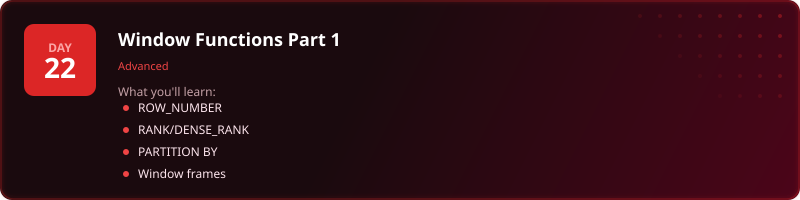
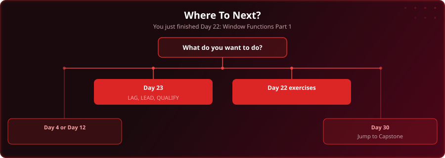

<p align="center">
  <a href="https://youtu.be/vzSM-vDyZIM"></a>
</p>

<p align="center">
  <a href="https://youtu.be/vzSM-vDyZIM"></a>
  
  
  
</p>

# Day 22 - Window Functions Part 1

[<< Day 21: Project: Recruitment Analytics](../day-21/) | [Day 23: Window Functions Part 2 >>](../day-23/)

---

### Contents
- [What You'll Learn](#what-youll-learn)
- [Dataset](#dataset)
- [Exercises](#exercises)
- [Key Concepts Covered](#key-concepts-covered)

---

## What You'll Learn

- What a window function is - a calculation that looks across related rows without collapsing them the way GROUP BY does
- The OVER clause - the one keyword that turns an aggregate into a window function, and the three shapes a window can take
- ROW_NUMBER - a clean 1, 2, 3 with no ties, and why it always needs a tie-breaker in the ORDER BY
- RANK - ties share a place, then the numbering skips
- DENSE_RANK - ties share a place, and the numbering never leaves a gap
- NTILE - splitting an ordered set into equal buckets, and why it splits by position rather than by value
- PARTITION BY - restarting the calculation for every group, so each category gets its own leaderboard
- Rank first, then filter - why WHERE cannot see a rank, and the inner-rank, outer-filter pattern that gets you the top row per group

## Prerequisites

> **First time here?** You need PostgreSQL and pgAdmin installed.
> [Watch the setup guide](https://youtu.be/g8GwhsVPaOg) | [Start from Day 1](../day-01/)

- Complete Days 1-21. Today leans on Day 4 (GROUP BY) for the contrast, and on Day 12 (subqueries) for the outer-filter pattern

## Dataset

Today uses two datasets. Run the SQL in [setup.sql](setup.sql) to create everything, or run [exercise.sql](exercise.sql) for just the exercise table.

**Teaching dataset - marathon finish times.** A local marathon with runners in three age categories, and several runners sharing the same finish time, which is exactly what makes ranking interesting:

- **marathon_results**: 12 rows, one per runner - name, age category (Under-40, 40-49, 50-plus) and finish time in minutes

**Exercise dataset - Year 11 mock exam results.** Grain is one row per student per subject:

- **mock_results**: 24 rows - 8 students, each sitting Maths, English and Science, with an exam mark and a coursework mark out of 100

Exam marks are whole numbers, so students land on the same mark more than once. Those ties are deliberate.

### Setup

Run [setup.sql](setup.sql) to create and populate both the teaching and the exercise tables. Re-running it is safe - it drops and rebuilds both tables.

### Verification

After running the setup, verify your tables:

```sql
SELECT COUNT(*) FROM marathon_results; -- expected: 12 rows
SELECT COUNT(*) FROM mock_results; -- expected: 24 rows
```

## Exercises

You are the data person at a secondary school. Every winter the Year 11 students sit their mock exams - practice papers a few months before the real thing - and the school uses the results to see who is on track, put students into sets, and award a prize to the top student in each subject.

**Delphine**, the Head of Year 11, has sent you a message:

> Prize evening is next week and I need the mock results sorted. First, show me the Maths results ranked - and be honest about any ties. Then rank every subject separately and split each one into four sets for next term. Finally, give me one prize winner per subject. If two students tie on the exam, their coursework decides it - I'm not tossing a coin in front of the parents.

The catch is in the data. Ottilie and Clemmie are both on 88 in English, sharing the top spot, and there are two more tied marks in Maths. The ties are real, so the ranking function you pick changes the answer Delphine gets - and who goes home with a prize.

Here is what you need to work out:

- **Explore the data.** Look at the 24 results sorted by subject and mark. Check every subject has a full set of 8 students and see how far the marks run in each one. Then find every mark that more than one student shares in the same subject - there are three.
- **Task 1 - Rank the Maths results three ways.** Filter to Maths and put `ROW_NUMBER`, `RANK` and `DENSE_RANK` side by side, best mark first. Read across the two students on 84 and the two on 72, and decide which column answers "how many people beat me?" and which answers "what was the 3rd-highest mark?".
- **Task 2 - Rank every subject and split into sets.** Use `PARTITION BY subject` so each subject gets its own leaderboard without losing a row, then add `NTILE(4)` inside the same partition to split each subject into four teaching sets. Look at Science set 4 and ask why two good marks landed there, and look at the two Maths students on 84 and ask why they ended up in different sets.
- **Task 3 - One prize winner per subject.** Rank each subject with `ROW_NUMBER`, ordering by exam mark and then coursework mark so a tie on the exam is settled fairly. Then wrap it in an outer query and keep only position 1 - you cannot filter a rank in WHERE, because WHERE runs before the rank exists.

### Exercise Setup

Run [exercise.sql](exercise.sql) to create just the exercise table.

### Take it further

The video sets a take-home. Try `NTILE(10)` on the whole marathon field for deciles, rank the runners within each age category using `DENSE_RANK` instead of `RANK` and compare, or write the "top 2 per subject" version of Task 3 by changing the outer filter.

### Solutions

Finished? Check your answers: [`solutions.sql`](solutions.sql)

## Key Concepts Covered

- **A window function keeps every row** - GROUP BY squashes many rows into one per group; a window function does the same calculation but keeps every row and adds the answer alongside as a new column
- **OVER switches the window on** - empty brackets make the window the whole result set; `PARTITION BY` breaks it into groups and restarts the calculation in each; an `ORDER BY` inside the brackets gives the function a sequence to rank along
- **Pick your ranking function by how it treats a tie** - `ROW_NUMBER` forces ties apart and needs a tie-breaker or the split is arbitrary; `RANK` lets ties share a place and then skips, so it answers "how many are ahead of me?"; `DENSE_RANK` lets ties share a place with no gap, so it answers "what is the Nth-highest value?"
- **NTILE splits by position, not by value** - it always fills every bucket as evenly as it can, however well or badly everyone did; a threshold ("70 or more") is a `CASE WHEN` on the mark, not an NTILE
- **Rank first, then filter** - WHERE runs before the window function exists, so you cannot filter on a rank directly; rank in an inner query and filter in an outer one, and that is how you get the top row in every group

---

<p align="center">
  <a href="https://www.youtube.com/@sdw-online?sub_confirmation=1"></a>
</p>

## Where To Next?

<p align="center">
  
</p>

---

<p align="center">
  <a href="../day-21/">&#9664; Day 21: Project: Recruitment Analytics</a> &nbsp;&nbsp;|&nbsp;&nbsp; <a href="../day-23/">Day 23: Window Functions Part 2 &#9654;</a>
</p>

---

<!-- CLIFFHANGER -->
<p align="center"><sub><b>UP NEXT</b></sub></p>
<p align="center"><a href="../README.md#curriculum"><b>Day 23 coming soon &raquo;</b></a></p>
<p align="center"><b>Day 23 &nbsp;&middot;&nbsp; Window Functions Part 2</b></p>
<p align="center"><i>Window functions replace 80% of the SQL you used to write.</i></p>
<!-- /CLIFFHANGER -->
