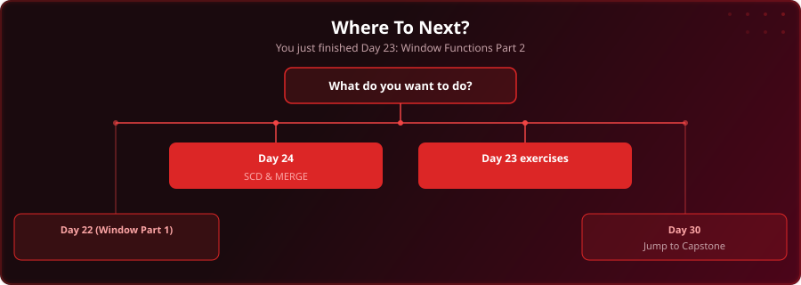

<p align="center">
  <a href="https://youtu.be/Tz1VzkEzgZM"></a>
</p>

<p align="center">
  <a href="https://youtu.be/Tz1VzkEzgZM"></a>
  
  
  
</p>

# Day 23 - Window Functions Part 2

[<< Day 22: Window Functions Part 1](../day-22/) | [Day 24: SCD Types & MERGE >>](../day-24/)

---

### Contents
- [What You'll Learn](#what-youll-learn)
- [Dataset](#dataset)
- [Exercises](#exercises)
- [Key Concepts Covered](#key-concepts-covered)

---

## What You'll Learn

- Running totals - SUM() OVER with an ORDER BY inside the brackets, so the total grows row by row, and PARTITION BY to restart it for each group
- LAG - pulling the previous row's value onto the current row for month-over-month comparisons, and keeping it in its lane with PARTITION BY
- LEAD - the mirror image of LAG, looking at the next row instead of the previous one
- Moving averages - frame clauses (ROWS BETWEEN ... PRECEDING AND CURRENT ROW) that smooth out noisy numbers
- FIRST_VALUE and LAST_VALUE - anchoring every row to a fixed starting or ending point, and the LAST_VALUE frame trap
- QUALIFY - filtering on a window function in one step on Snowflake, BigQuery and Databricks, and the CTE workaround PostgreSQL needs

## Prerequisites

> **First time here?** You need PostgreSQL and pgAdmin installed.
> [Watch the setup guide](https://youtu.be/g8GwhsVPaOg) | [Start from Day 1](../day-01/)

- Complete Days 1-22. Today builds directly on Day 22 (ROW_NUMBER, RANK, PARTITION BY) and on the CTE pattern from earlier in the course

## Dataset

Run the SQL in [setup.sql](setup.sql) to create everything, or run [exercise.sql](exercise.sql) for just the exercise table.

**Teaching datasets:**

- **monthly_revenue**: 90 rows - 5 departments x 18 months (Jul 2023 to Dec 2024), with revenue, new clients and renewal rate. Engineering has a dip in Nov 2024
- **daily_web_metrics**: 92 rows - one per day from 1 Oct 2024 to 31 Dec 2024, with page views, unique visitors and signups. It has a Black Friday spike on 29 Nov 2024

**Exercise dataset:** the exercise reuses **monthly_revenue**, so there is no extra table to load.

### Setup

Run [setup.sql](setup.sql) to create and populate both tables. Re-running it is safe - it drops and rebuilds them.

### Verification

After running the setup, verify your tables:

```sql
SELECT COUNT(*) FROM monthly_revenue; -- expected: 90 rows
SELECT COUNT(*) FROM daily_web_metrics; -- expected: 92 rows
```

## Exercises

You work in the analytics team of a fintech company. **Ruth**, the Head of Finance, presents to the board every three months and has asked you to build the numbers for the next meeting:

> The board does not want a checklist of raw numbers. They want the story. Is each department growing or shrinking from month to month? How much has each department brought in so far this year? And underneath all the ups and downs, is the real trend going up or down? I'm worried about Engineering - November dropped hard. Is that the start of a decline, or just one bad month?

Everything lives in one table, `monthly_revenue`. Here is what you need to work out:

- **Explore the data.** Preview the table, check how many rows it has (90) and list the five departments.
- **Task 1 - Month-over-month change per department.** Use `LAG` with `PARTITION BY department_id` to bring last month's revenue onto each row, then work out the change in pounds and in percent. Watch what happens on each department's first month, and what Engineering's November looks like.
- **Task 2 - Year-to-date running total per department.** Use `SUM() OVER` with `PARTITION BY` and an `ORDER BY` for 2024 only, so each department's total grows month by month and restarts from zero for the next department.
- **Task 3 - Smooth the trend and label it.** Build a 3-month moving average with `ROWS BETWEEN 2 PRECEDING AND CURRENT ROW`, then compare each average to the previous one with `LAG` and label it Accelerating, Decelerating or Stable. You will need a CTE, because a window function cannot sit inside another window function. Then answer Ruth: was November the start of a decline?

### Exercise Setup

Run [exercise.sql](exercise.sql) to create just the exercise table.

### Take it further

The video sets a take-home. Use `FIRST_VALUE` and `LAST_VALUE` to compare every month to the start and end of the year (remember the full frame for `LAST_VALUE`), write the "top 2 months per department" version with a CTE in place of `QUALIFY`, or try a 6-month moving average on `daily_web_metrics` to see the Black Friday spike flatten out.

### Solutions

Finished? Check your answers: [`solutions.sql`](solutions.sql)

## Key Concepts Covered

- **A running total is SUM() OVER with an ORDER BY** - the ORDER BY inside the brackets is the hidden switch that makes the total grow row by row; PARTITION BY restarts it for each group
- **LAG looks back, LEAD looks forward** - both pull a value from a neighbouring row onto the current one, so a month-over-month change is one subtraction. Always add PARTITION BY, or one group borrows values from another
- **A frame clause decides which rows a calculation can see** - `ROWS BETWEEN 2 PRECEDING AND CURRENT ROW` gives a 3-row moving average, and the first rows of each group average over fewer rows
- **LAST_VALUE needs the full frame** - with an ORDER BY the default frame stops at the current row, so LAST_VALUE just returns the current row's value unless you add `ROWS BETWEEN UNBOUNDED PRECEDING AND UNBOUNDED FOLLOWING`
- **QUALIFY filters on a window function, PostgreSQL does not have it** - the order SQL runs is FROM, WHERE, then the window function, so WHERE cannot see a rank. Snowflake, BigQuery and Databricks have QUALIFY; in PostgreSQL, rank in a CTE and filter in the outer query
- **Smooth first, then judge** - one bad month is noise; compare moving averages to see whether the trend itself has turned

---

<p align="center">
  <a href="https://www.youtube.com/@sdw-online?sub_confirmation=1"></a>
</p>

## Where To Next?

<p align="center">
  
</p>

---

<p align="center">
  <a href="../day-22/">&#9664; Day 22: Window Functions Part 1</a> &nbsp;&nbsp;|&nbsp;&nbsp; <a href="../day-24/">Day 24: SCD Types & MERGE &#9654;</a>
</p>

---

<!-- CLIFFHANGER -->
<p align="center"><sub><b>UP NEXT</b></sub></p>
<p align="center"><a href="../README.md#curriculum"><b>Day 24 coming soon &raquo;</b></a></p>
<p align="center"><b>Day 24 &nbsp;&middot;&nbsp; SCD Types & MERGE</b></p>
<p align="center"><i>SCD Types & MERGE - the thing most people get wrong.</i></p>
<!-- /CLIFFHANGER -->
