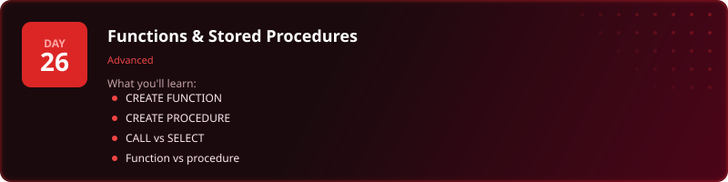
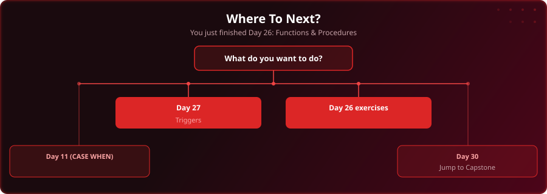

  

  
  
  

# Day 26 - Functions & Stored Procedures

[<< Day 25: Views & Materialised Views](../day-25/) | [Day 27: Triggers >>](../day-27/)

---

## What You'll Learn

- How to write scalar and set-returning functions in PostgreSQL with CREATE FUNCTION and PL/pgSQL
- How parameters, default values, and the IMMUTABLE, STABLE and VOLATILE labels shape a function
- How CREATE PROCEDURE and CALL differ from a function, including COMMIT and ROLLBACK inside a procedure (PostgreSQL 11+)
- How to choose between a function and a procedure - the classic interview question

---

## Where To Next?

  

---

  <a href="../day-25/">&#9664; Day 25: Views & Materialised Views</a> &nbsp;&nbsp;|&nbsp;&nbsp; <a href="../day-27/">Day 27: Triggers &#9654;</a>

---

<!-- CLIFFHANGER -->

<b>UP NEXT</b>

<a href="../README.md#curriculum"><b>Day 27 coming soon &raquo;</b></a>

<b>Day 27 &nbsp;&middot;&nbsp; Triggers</b>

<i>The code that runs when nobody asked it to. Handle with care.</i>

<!-- /CLIFFHANGER -->
