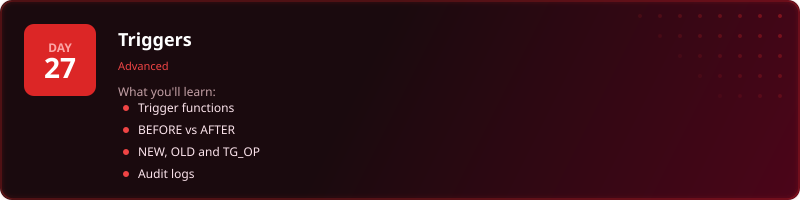
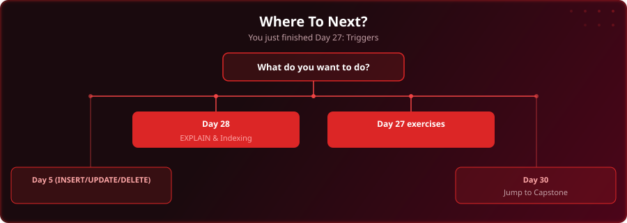

  

  
  
  

# Day 27 - Triggers

[<< Day 26: Functions & Stored Procedures](../day-26/) | [Day 28: EXPLAIN & Indexing >>](../day-28/)

---

## What You'll Learn

- What a trigger is, and the two-step PostgreSQL pattern: a trigger function that RETURNS trigger, then CREATE TRIGGER to attach it
- The difference between BEFORE and AFTER triggers, and between FOR EACH ROW and FOR EACH STATEMENT
- How NEW, OLD and TG_OP work - including why OLD is NULL on an INSERT
- How returning NULL from a BEFORE row trigger silently cancels the change
- How to build an audit log table and an automatic updated_at column
- When not to use a trigger: hidden logic, write cost, and debugging

---

## Where To Next?

  

---

  <a href="../day-26/">&#9664; Day 26: Functions & Stored Procedures</a> &nbsp;&nbsp;|&nbsp;&nbsp; <a href="../day-28/">Day 28: EXPLAIN & Indexing &#9654;</a>

---

<!-- CLIFFHANGER -->

<b>UP NEXT</b>

<a href="../README.md#curriculum"><b>Day 28 coming soon &raquo;</b></a>

<b>Day 28 &nbsp;&middot;&nbsp; EXPLAIN & Indexing</b>

<i>Lookups separate the spreadsheet person from everyone else.</i>

<!-- /CLIFFHANGER -->
