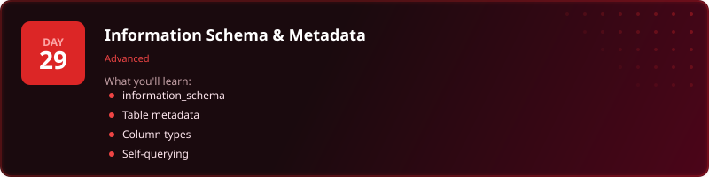
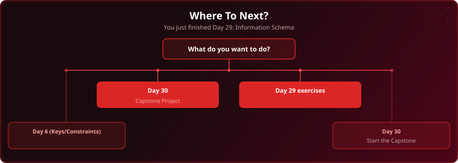

  

  
  
  

# Day 29 - Information Schema & Metadata

[<< Day 28: EXPLAIN & Indexing](../day-28/) | [Day 30: Capstone: FinTech Lending Analytics >>](../day-30/)

---

## What You'll Learn

- How to query your database about itself using information_schema and pg_catalog
- How to list all tables, inspect columns, and map foreign key relationships with SQL
- How to use pg_catalog to find indexes, table owners, and column comments
- How to auto-generate a complete data dictionary from database metadata

---

## Where To Next?

  

---

  <a href="../day-28/">&#9664; Day 28: EXPLAIN & Indexing</a> &nbsp;&nbsp;|&nbsp;&nbsp; <a href="../day-30/">Day 30: Capstone: FinTech Lending Analytics &#9654;</a>

---

<!-- CLIFFHANGER -->

<b>UP NEXT</b>

<a href="../README.md#curriculum"><b>Day 30 coming soon &raquo;</b></a>

<b>Day 30 &nbsp;&middot;&nbsp; Capstone: FinTech Lending Analytics</b>

<i>Capstone: FinTech Lending Analytics - the thing most people get wrong.</i>

<!-- /CLIFFHANGER -->
